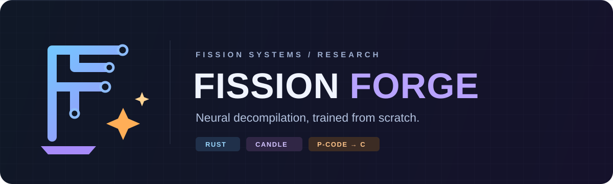

<p align="center">
  
</p>

<p align="center">
  <a href="https://github.com/fission-systems">Fission Systems</a> ·
  <a href="docs/training.md">Training</a> ·
  <a href="docs/research/input-representations.md">Input representations</a> ·
  <a href="docs/evaluation.md">Evaluation</a> ·
  <a href="LICENSE">AGPL-3.0</a>
</p>

# Fission Forge

**A Rust research workspace for a neural decompiler trained from scratch.**

Forge explores how far a small, dedicated model can go from binary-derived
intermediate representations to C. The model, automatic differentiation, and
training loop use Rust and [Candle](https://github.com/huggingface/candle).
[Fission](https://github.com/fission-systems/Fission) supplies the intended
SLEIGH/P-code frontend; [DecBench](https://github.com/Noelo-Lab/decbench) is the
selected external evaluation protocol.

The initial scope is **C functions on x86-64**. Our weights start from random
initialization. [LLM4Decompile](docs/research/llm4decompile.md) informs the research,
but Forge is an independent implementation rather than a fine-tune of its models.

## Current state

This repository contains a working **training prototype**, with CPU and Colab
A100 checks. It does not yet ship a usable decompiler or a pretrained checkpoint.

| Component | What exists today |
| --- | --- |
| Rust causal decoder | Multi-head causal attention, learned positions, pre-layer normalization, GELU feed-forward layers |
| Training | Byte tokens, completion-only next-token loss, deterministic initialization, AdamW |
| Checkpoints | Safetensors weights and optimizer moments; reload and next-update equivalence checks |
| Model sizes | 61,888-parameter IR probe, 148,608-parameter assembly smoke model, and 99,927,552-parameter experimental configuration |
| CUDA | 148K and approximately 100M assembly probes exercised on a Colab A100 40 GB; IR lane tested on CPU |
| Input data | Four handwritten assembly/C pairs and three compiled C/P-code fixture pairs; software checks only |
| P-code frontend | Typed raw-dump validation, pinned SLA profile, reproducible owned-C extraction, and explicit unsupported records |
| P-code+ / SSA | Version 0 supports straight-line scalar SSA, overlapping register writes, and conservative effect ordering; CFG/call support pending |
| DecBench | Evaluation protocol documented; adapter and scoring run pending |

The fixed-batch trainer accepts at most 32 examples and rejects truncation. Corpus
streaming, generation, mixed precision, and generalization evaluation remain to be
implemented. Loss reduction on the smoke fixtures is not evidence of decompilation
quality.

## Research direction

```text
Binary → Fission SLEIGH → raw P-code → P-code+ / SSA v0 → Forge training
                                       straight-line     fixed-batch

Planned next: CFG / calls → corpus training → C generation → DecBench
```

P-code is the selected IR family. A small x86-64 subset of **P-code+ with SSA**
is implemented and connected to the trainer. It preserves widths, numeric-domain
opcodes, register overlap, effect order, and lifting provenance. Branches, loops,
calls, unknown operations, and incomplete lifts are explicitly rejected. SSA
describes definitions and uses; it does not replace semantic contracts. HIR is
an optional later comparison.

See [the executable input lane and commands](docs/pcode.md) and
[representation experiments and P-code+ boundaries](docs/research/input-representations.md).
The current IR run exercises three compiled fixtures; it is not corpus pretraining
or evidence of decompiler quality. A CPU run verified byte-identical checkpoints
for 8+2 resumed versus 10 uninterrupted updates; see [IR evidence](evidence/2026-10-20-pcode-v0/README.md).

## Run locally

Install a current stable Rust toolchain, then run from the repository root:

```sh
git clone https://github.com/fission-systems/fission-forge.git
cd fission-forge
cargo test --locked --workspace

cargo run --locked --release -p fission-forge -- train-smoke \
  --config configs/model/tiny.json \
  --dataset fixtures/smoke/pairs.jsonl \
  --output outputs/tiny-cpu --steps 32
```

The command writes a JSON report, `state.json`, and `training.safetensors`.
Choose a fresh output path for each run; existing directories are refused.
To resume for eight additional steps:

```sh
cargo run --locked --release -p fission-forge -- train-smoke \
  --config configs/model/tiny.json \
  --dataset fixtures/smoke/pairs.jsonl \
  --resume outputs/tiny-cpu \
  --output outputs/tiny-cpu-resumed --steps 8
```

A separate synthetic tensor check is available through
`backend-probe --output outputs/backend-cpu`. CUDA builds use `--features cuda`
and `--device cuda`; Metal builds use `--features metal` and `--device metal`.
GPU requests fail explicitly if their backend is unavailable. Metal has not been
validated in this project.

## Colab evidence

On **2026-10-20 KST**, the Rust/Candle CUDA implementation ran on a Colab
**A100-SXM4 40 GB**, using F32 and four examples with a padded sequence length of
57 tokens:

| Configuration | Updates | Initial → final loss | Observed device memory peak |
| --- | ---: | ---: | ---: |
| 148,608 parameters | 32 | 5.5613 → 0.4161 | 546 MiB |
| 99,927,552 parameters | 2 | 5.5390 → 3.5934 | 4,322 MiB |

Both runs reported zero error for checkpoint logits and the compared resumed
AdamW update. Memory was sampled every 0.5 seconds across the whole GPU and may
miss transient peaks. The 100M run establishes a short training/checkpoint
feasibility check; it does not establish long-context capacity, sustained
throughput, or model quality.

[Recorded reports and provenance](evidence/2026-10-20-a100/README.md) are committed.
[Training documentation](docs/training.md) explains measurement scope and Colab
reproduction. Python in [the Colab driver](scripts/colab/transformer_probe.py)
handles orchestration; model computation stays in Rust. Runtime allocation is
manual and should be stopped after collecting results.

## Evaluation

Use a pinned DecBench evaluator, dataset revision, and target manifest. Report
GED, type match, byte match, and the upstream Union score on matching scopes,
alongside lifting coverage and input conditions. DecBench evaluation targets
must remain excluded from training.

The evaluation configuration is currently **protocol only**: dataset revision,
evalkit digest, and target-manifest digest are intentionally unset until an
actual run is prepared. No DecBench score is claimed here. See
[the protocol](docs/evaluation.md) and [reference configuration](configs/evaluation/decbench.json).

## Repository map

| Path | Purpose |
| --- | --- |
| [`crates/forge/`](crates/forge/) | Rust model, byte codec, loss, optimizer, checkpoint checks, and CLI |
| [`configs/model/`](configs/model/) | Tiny and approximately 100M model configurations |
| [`fixtures/smoke/`](fixtures/smoke/) | Hand-authored assembly fixtures |
| [`fixtures/pcode/`](fixtures/pcode/) | Owned C, real raw dumps, supported IR pairs, and unsupported control-flow fixtures |
| [`scripts/colab/`](scripts/colab/) | CUDA build and bounded probe orchestration |
| [`evidence/`](evidence/) | Small, recorded measurement reports; no model weights |
| [`docs/research/`](docs/research/) | Paper notes and IR design hypotheses |
| [`assets/`](assets/) | Self-contained SVG banner and mark |

The optional Fission comparison clone belongs in `external/Fission/` and is
ignored. Build outputs, local runs, and checkpoints in `outputs/` are also ignored.
No GitHub, Colab, or Hugging Face credentials belong in this repository.

## Development

```sh
cargo fmt --all -- --check
cargo test --locked --workspace
cargo clippy --locked --workspace --all-targets -- -D warnings
python3 -m py_compile scripts/colab/transformer_probe.py
```

Tests cover causal masking, shifted completion loss, prompt/padding exclusion,
AdamW agreement with Candle, overlapping register SSA, domain/effect retention,
input isolation, and fail-closed IR validation. Runtime probes separately check checkpoint
reload and resumption. Any new IR lane needs deterministic serialization,
semantic-preservation checks, and explicit unsupported-input reporting before
corpus training.

## License

[GNU Affero General Public License v3.0](LICENSE). Upstream tools, datasets, and
model artifacts retain their respective licenses.
